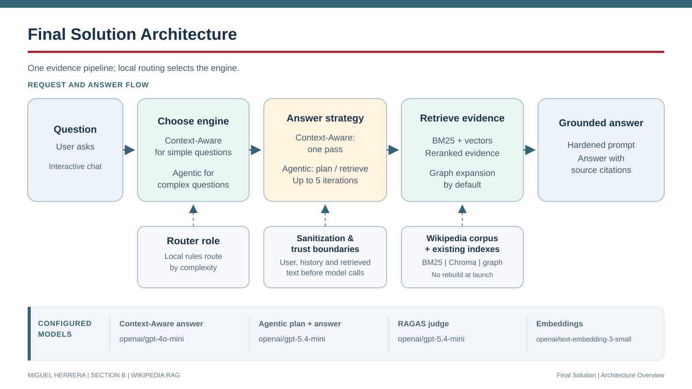

# CAPSTONE PROJECT
### RAG and Context Engineering: Designing and Building Production-Grade AI Systems

**Miguel Herrera - Section B**

## Overview

A Wikipedia retrieval-augmented generation (RAG) system combining BM25 lexical
search, Chroma vector retrieval, and optional graph expansion.

- **Context-Aware:** single-pass, history-aware retrieval for predictable cost.
- **Agentic Dynamic:** iterative planning and retrieval for complex questions.

Both engines support baseline and hardened operation. Sanitization and tagged
trust boundaries are defense-in-depth, not security or factual-correctness guarantees.



## Start Here

| Goal | Resource |
| --- | --- |
| Set up and run the Final Solution | [Final Solution Setup and Run](#final-solution-setup-and-run) |
| Browse implementations and shared utilities | [Capstone_Checkpoints](Capstone_Checkpoints/), [Capstone_Final_Solution](Capstone_Final_Solution/), and [Capstone_Utilities](Capstone_Utilities/) |
| Set up and run checkpoints 1.1-7.1 | [Checkpoint setup and run guide](Capstone_Checkpoints/Checkpoint_Readme.md) |
| Review Final Solution results, checkpoint experiments, and engineering trade-offs | [Testing results](Capstone_Checkpoints/Checkpoint_Testing_Results.md) |
| Review raw reports and evaluation CSVs | [Capstone_Ragas_Experiments](Capstone_Ragas_Experiments/) |

The checkpoint guide contains Windows PowerShell and macOS Zsh/Bash commands,
dataset instructions, troubleshooting, and offline checks. Historical results
are preserved separately and are not certification of the current implementation.

## Final Solution Setup and Run

The Final Solution is a Wikipedia retrieval-augmented generation (RAG)
application: it combines BM25 lexical retrieval, Chroma vector search, and
graph expansion to answer questions from retrieved articles. It offers a
single-pass Context-Aware engine and an iterative Agentic Dynamic engine; the
default configuration routes between them automatically.

From the repository root, create an environment, install the Final Solution's
pinned dependencies, configure credentials and data paths, and launch the
application.

Windows PowerShell:

```powershell
python -m venv .venv
.\.venv\Scripts\python.exe -m pip install -r .\Capstone_Final_Solution\requirements.txt
$env:OPENROUTER_API_KEY = "your-api-key"
.\.venv\Scripts\python.exe .\Capstone_Final_Solution\MHERRERA_Capstone_8_1_Automatic_Hardened_Hybrid_Graph.py
```

macOS (Zsh/Bash):

```bash
python3 -m venv .venv
./.venv/bin/python -m pip install -r ./Capstone_Final_Solution/requirements.txt
export OPENROUTER_API_KEY="your-api-key"
./.venv/bin/python ./Capstone_Final_Solution/MHERRERA_Capstone_8_1_Automatic_Hardened_Hybrid_Graph.py
```

The commands above set `OPENROUTER_API_KEY` for the current terminal session;
alternatively, provide it through a local `.env` file. Never commit credentials.
The application dependencies are pinned in
[Capstone_Final_Solution/requirements.txt](Capstone_Final_Solution/requirements.txt);
the shared [venv_requirements.txt](venv_requirements.txt) is an alternative
dependency list for the broader project. Offline validation used Python
3.12.10 on Windows; other versions and macOS/Linux execution have not been
certified.

Configure paths and runtime defaults in
[Final_Solution_Retrieval.conf](Capstone_Final_Solution/Final_Solution_Retrieval.conf).
The default database path is resolved relative to the solution folder and
expects the sibling `Capstone_Database` folder at the repository root. Change
that setting when relocating the solution. On macOS, set `[paths] database_dir`
to `../Capstone_Database`. The required Wikipedia HTML/JSONL corpus, BM25 index,
Chroma index, and graph artifacts are not included. Missing artifacts produce
an explicit error; the Final Solution does not depend on the shared setup
script or database builders and never builds or copies the artifacts. Hybrid
ranking is implemented in the solution-local
[Ranking_Techniques](Capstone_Final_Solution/Ranking_Techniques/) package;
checkpoint launchers and configuration are not imported.

### Final Solution behavior and configuration

The default configuration runs hardened chat with automatic engine routing and
graph-enabled retrieval. Simple questions use Context-Aware with GPT-4o-mini;
recognized complex questions use Agentic Dynamic with GPT-5.4-mini. Both use
four graph seeds and a 14,000-character retrieved-context limit. Runtime paths,
retrieval settings, ranking weights, and models are configured in
[Final_Solution_Retrieval.conf](Capstone_Final_Solution/Final_Solution_Retrieval.conf).
Existing Chroma embeddings must match the configured embedding model.

The launcher also retains explicit-engine evaluation, engine comparison,
cost-experiment, and hardening-test workflows. Evaluation questions come from
[Capstone_Ragas_Experiments/Test_Variables](Capstone_Ragas_Experiments/Test_Variables/);
the comparison, hardening, and cost summary is written to
`final_solution_8_1_optimization_performance.log` in
[Capstone_Ragas_Experiments](Capstone_Ragas_Experiments/). Other RAGAS logs and
per-question CSVs are written there as well. The cost experiment compares only
GPT-4o-mini and GPT-5.4-mini, configured by
[final_solution_8_1_cost_experiment_prototype.py](Capstone_Final_Solution/Utility_Scripts/final_solution_8_1_cost_experiment_prototype.py).

### Final Solution retrieval and evidence

- Exact-title and unambiguous surname matching improve article selection;
  ambiguous surname matches are not forced.
- A bounded, in-memory HTML overlay extracts article introductions while
  excluding menus, tables/infoboxes, hatnotes, and references. It does not
  modify or rebuild the persisted corpus or indexes.
- Hybrid candidates are deterministically reranked using title match, passage
  word overlap, introductory relevance for overview questions, and navigation
  penalties; no reranker LLM call is added. Graph expansion uses linked-article
  introductions and keeps ranked seeds ahead of expanded neighbors.
- New questions are searched independently of prior assistant responses;
  pronoun follow-ups also use the previous user question.
- Prompts request excerpt-ID citations and article titles. A deterministic
  **Sources (retrieved evidence)** footer lists documents supplied to the model;
  it indicates provenance, not proof that every claim is supported.
- The local Agentic engine sanitizes inputs and documents, uses tagged trust
  boundaries, retrieves before planning, reports malformed planner output,
  bounds clarification rounds, and handles local quit commands. Generated
  answer text does not control session termination.

The existing indexed chunks still contain some extraction noise. The
introductory evidence overlay does not replace a clean-corpus rebuild or a
learned reranker. Alias resolution and follow-up interpretation are
deterministic heuristics, not general entity-linking or query-rewriting models.

## Reviewer Notes and Limitations

- Running the application requires network access and an OpenRouter API key.
  Embedding, answer-generation, and Agentic planning calls can incur charges.
- Results depend on the corpus and prebuilt indexes supplied locally. Chroma
  embeddings must match the configured embedding model; a fresh clone alone is
  not sufficient to run the full application.
- Retrieval and follow-up interpretation include deterministic heuristics.
  Indexed chunks may contain extraction noise, citations need evaluation, and
  the source footer indicates provenance but does not guarantee factual support.
- Evaluation datasets are small and some historical scores predate current
  implementation changes; they do not establish general reliability. Consult
  [testing results](Capstone_Checkpoints/Checkpoint_Testing_Results.md) for
  methodology, results, and known caveats.

## Project Organization

| Area | Purpose |
| --- | --- |
| [Capstone_Checkpoints](Capstone_Checkpoints/) | Checkpoints 1.1-7.1, checkpoint configuration, question datasets, and documentation |
| [Capstone_Final_Solution](Capstone_Final_Solution/) | Automatic hardened, graph-enabled final Wikipedia RAG solution |
| [Capstone_Utilities](Capstone_Utilities/) | Shared checkpoint retrieval/ranking modules, utility scripts, and JSON schemas |
| [Capstone_Utilities/Retrieval_Methods](Capstone_Utilities/Retrieval_Methods/) | Retrieval modules shared by checkpoints 4.1-7.1 |
| [Capstone_Utilities/Ranking_Techniques](Capstone_Utilities/Ranking_Techniques/) | Weighted ranking shared by checkpoint retrieval workflows |
| [Capstone_Utilities/JSON_Schemas](Capstone_Utilities/JSON_Schemas/) | JSON schemas used by question-generation utilities |
| [Capstone_Ragas_Experiments](Capstone_Ragas_Experiments/) | Local evaluation datasets, reports, experiment logs, and CSV results |
| [venv_requirements.txt](venv_requirements.txt) | Direct Python dependencies for the documented project workflows |

## Requirements and Operational Warnings

- **Environment:** Use `venv` and `pip` with the applicable dependency list.
  Python 3.12.10 on Windows was validated; no project-wide minimum is declared,
  and other runtimes/platforms are not certified.
- **Credentials and costs:** Set `OPENROUTER_API_KEY`; never commit it.
  Installation and API calls require network access. Generation, judging, and
  embeddings may incur charges.
- **Data:** Supply compatible corpus/index artifacts and adequate storage.
  HTML supports chunking/graph creation; JSONL supports BM25/Chroma creation.
- **Checkpoint setup:** Follow the [checkpoint guide](Capstone_Checkpoints/Checkpoint_Readme.md).
  Existing environments are not refreshed automatically. Checkpoints 4.1-7.1
  check artifacts before menus and may trigger paid builds; `--help` skips setup.
  Rebuilds can overwrite artifacts.
- **Imports:** Checkpoints 1.1-2.1 run live workflows on import; do not use them
  as offline smoke tests.

## Evaluation Summary

Historical experiments show a cost/accuracy trade-off:

- Context-Aware generally uses fewer model calls and tokens.
- Agentic can improve synthesis and multi-fact answers at higher cost and latency.
- Pure semantic retrieval and exact quotation fidelity remain limitations.
- Small, LLM-judged datasets do not establish general reliability.

[Testing results](Capstone_Checkpoints/Checkpoint_Testing_Results.md)
preserves the detailed tables, dates, methodology, output references, model
configurations, embedding budget, and limitations. Historical hardening scores
predate the native shared Agentic fix and have not been rerun against it.
Reported model costs exclude judge and embedding usage where specified.